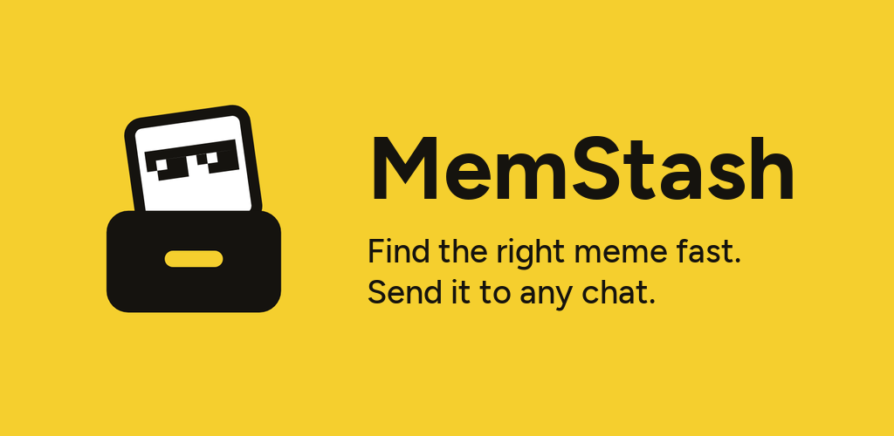
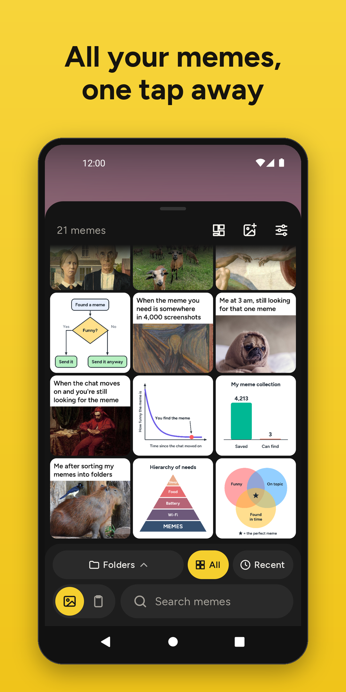
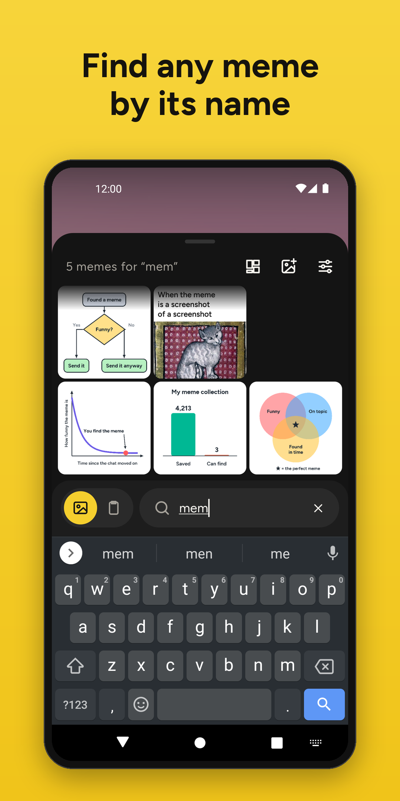
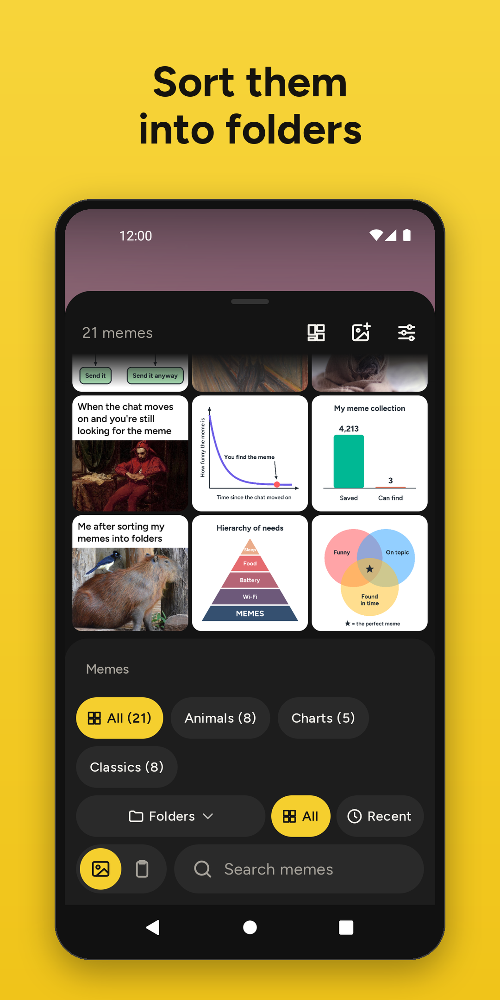
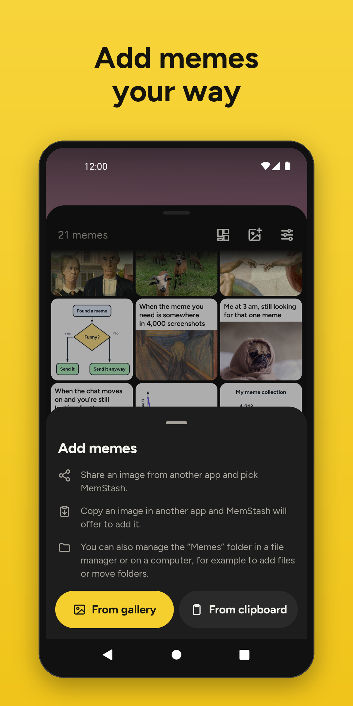
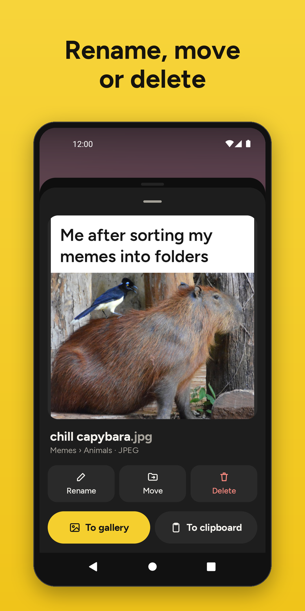
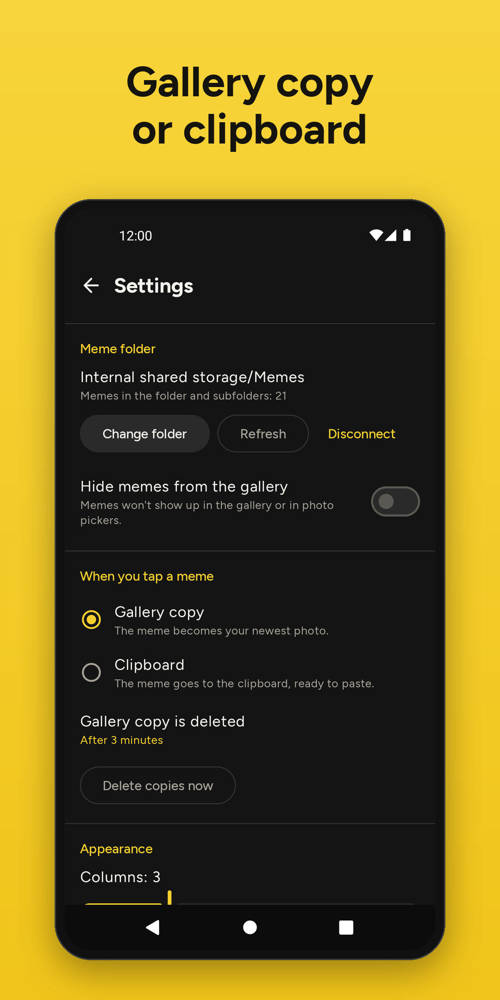

MemStash keeps your memes in a folder you choose and gets the right one into a chat in a few taps.

Open it from a Quick Settings tile on top of any chat app, type a few letters of the meme's name and tap it. MemStash hands the meme over the way the chat can take it:

- **Gallery copy** - the meme becomes your newest photo, first in the chat's gallery picker. Each copy replaces the previous one and is deleted automatically, after 3 minutes by default.
- **Clipboard** - paste the meme from your keyboard.

## Your memes, your folder

- Memes are ordinary image files in a folder you pick. The file name is the meme's name, subfolders work as categories.
- Search ignores case and accents and forgives typos.
- Rename, move and delete memes and create, rename and delete folders in the app, or manage the folder with any file manager or from a computer.
- Add memes by sharing an image to MemStash, from the photo picker, or by pasting an image you copied in another app.
- JPEG, PNG, GIF, WebP, HEIC, AVIF and BMP (AVIF previews need Android 12 or newer).

## Private by design

- No internet access, no ads, no tracking, no account.
- Access only to the one folder you choose - no storage permission.

## Screenshots

<p align="center">
  
  
  
  
  
  
</p>

## Good to know

- Android's backup doesn't include your memes. To move them to a new phone, copy the meme folder with a file manager or a computer, or keep it in a cloud folder and pick it on the new phone.
- The gallery copy is Pictures/MemStash/memstash.jpg (or .png, .gif and so on). If your gallery app backs up all albums, turn off the backup of that album.
- If you uninstall MemStash while a gallery copy is still there, Android keeps it and a reinstalled MemStash isn't allowed to delete it. When it's in the way of a new copy, MemStash asks you to delete it in your gallery.
- Both copies are the meme file unchanged, metadata included. If a meme is a camera photo with the date it was taken in its EXIF data, galleries that sort by that date show its gallery copy under that date instead of first; the clipboard isn't affected.

## Development

Requirements:

- JDK 17 or newer
- Android SDK with platform 37

```sh
./gradlew assembleDebug       # debug APK in app/build/outputs/apk/debug
./gradlew installDebug        # builds the debug APK and installs it on a connected phone
./gradlew testDebugUnitTest   # unit tests
./gradlew lintDebug           # lint, report in app/build/reports
./gradlew assembleRelease     # unsigned release APK in app/build/outputs/apk/release
./gradlew bundleRelease       # unsigned App Bundle in app/build/outputs/bundle/release
./gradlew clean               # deletes the build outputs
./gradlew tasks --all         # every task
```

The release APK is unsigned. To install it, sign it with your own key using `apksigner` from the Android SDK:

```sh
apksigner sign --ks <keystore> --ks-key-alias <alias> --out MemStash.apk app/build/outputs/apk/release/app-release-unsigned.apk
apksigner verify --print-certs MemStash.apk
```

## License

Copyright © 2026 Paweł Duraj

MemStash is free software: you can redistribute it and/or modify it under the terms of the GNU General Public License version 3 as published by the Free Software Foundation. See [LICENSE](LICENSE).

The bundled Figtree font is licensed under the SIL Open Font License 1.1 ([licenses/figtree_ofl_1_1.txt](licenses/figtree_ofl_1_1.txt)).
